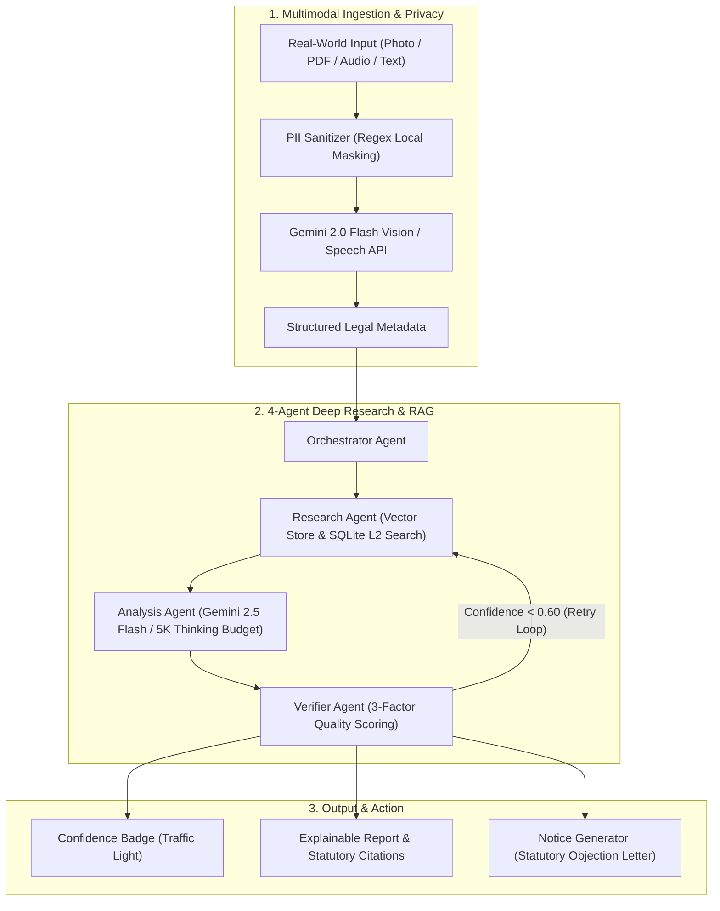

# ⚖️ Justice AI — Comprehensive Solution Proposal

## 1. Problem and Target User (≈100 words)
Everyday Indian citizens, consumers, and motorists frequently receive micro-penalties and dispute notices—such as ₹1,000 traffic e-challans, ₹20–₹50 retail MRP overcharges, and denied e-commerce refunds (₹500–₹5,000). While these financial burdens accumulate, victims struggle with a critical decision: **"Should I dispute this charge or just pay it?"**

Because hiring an advocate costs more than the dispute itself (₹5,000+ consultation fees) and official portals (Parivahan, eDaakhil, NCH) are buried in procedural jargon, 95%+ of citizens reluctantly pay unjustified fines. The affected user is the non-lawyer citizen navigating high-stakes micro-disputes with unstructured, real-world proof (camera photos, SMS tickets, blurred receipts).

---

## 2. Proposed Solution (≈150 words)
**Justice AI** is an AI-powered legal defense copilot providing an accessible, end-to-end pathway from dispute ingestion to official filing.

A user begins by uploading an unclean real-world input—a camera photo of an e-challan, a PDF receipt, or a voice note in Hindi or Indian English. The system sanitizes private PII (masking vehicle plates, phones, and ID numbers locally) and extracts structured facts (penalties, dates, alleged infractions) via Vision-Language models.

These facts are processed through an agentic legal pipeline (`Research`, `Analysis`, and `Verifier` agents) that performs semantic search over a curated vector corpus of Indian bare acts and judicial precedents. The system synthesizes an explainable legal report detailing win probability, applicable statutory provisions, and action steps. Finally, it closes the loop by auto-generating a customized, legally grounded representation or dispute notice ready to file on the Parivahan Virtual Court or National Consumer Helpline.

---

## 3. Key Features (5 Bullet Points)
* **Multimodal Document Intelligence with Local PII Masking**: Upload camera photos or PDFs of challans, invoices, or notices. The engine extracts key metadata (fine amounts, violation sections, merchant names) while locally redacting sensitive PII (vehicle plates, contact numbers, Aadhaar/PAN) before model processing.
* **4-Agent Deep Legal Research Brief**: Uses an Orchestrator-Research-Analysis-Verifier loop with a 5,000-token thinking budget to draft a 5-part legal brief (Issue Summary, Win Probability, Statutory Citations, Step-by-Step Action Plan, Caveats).
* **Traffic-Light Confidence Scoring & Verification**: An independent Verifier Agent grades drafts across Retrieval (30%), Citation Fidelity (45%), and Legal Logic (25%), displaying an intuitive badge (🟢 High ≥80%, 🟡 Medium 60–79%, 🔴 Low <60%) with automated disclaimers if confidence is low.
* **1-Click Statutory Dispute Notice Generator**: Converts analysis into a formal, jurisdiction-ready Legal Representation Letter or Consumer Notice (under MVA 1988, Legal Metrology Act 2009, or CPA 2019) that users can copy or download (`.txt`) for immediate submission.
* **Bilingual Nyay Voice Consultation**: Real-time spoken dialogue in Hindi and Indian English using Web Speech API and neural Indian voices, removing legal literacy barriers for non-English speakers.

---

## 4. Architecture and AI Techniques

**Architecture Overview (≈100 words):**  
Justice AI employs a modular multi-agent pipeline designed for strict legal fidelity. **Gemini 2.0 Flash Vision** handles noisy document OCR and structured metadata extraction. **Web Speech API / Cloud STT** enables zero-barrier Indian voice input. Semantic search queries a **SQLite vector database (1,763 indexed Indian law chunks)** using normalized embeddings.

Reasoning is split across specialized agents: **Gemini 2.5 Flash** acts as the Analysis Lawyer using an extended thinking budget, while a lightweight **Verifier Agent** cross-checks citations against retrieved ground truth chunks. This separation prevents hallucinations and ensures every assertion maps directly to Indian statutes.

---

## 5. Explainability
Justice AI rejects the "black-box chatbot" paradigm through three distinct explainability layers:
* **Statutory Grounding & Inline Citations**: Every legal statement is tied to explicit citation chips (`[1]`, `[2]`, `[3]`) referencing the exact Act, Section, and Year (e.g., *Motor Vehicles Act 1988 § 129 / 194D*, *Legal Metrology Act 2009 § 36(1)*, *Consumer Protection Act 2019 § 35*). Clicking a citation reveals the underlying excerpt.
* **Transparent Agent Execution Trace**: Deep Research exposes the complete chronological `agent_log` showing which search queries were executed, how many corpus chunks passed the relevance threshold, and how the Verifier scored the draft.
* **Reasoned Win Probability**: Rather than a static score, the system articulates *why* a case is winnable (e.g., *"Win Probability: 80% due to failure of electronic speed enforcement calibration under MVA Section 136A"*).

---

## 6. Responsible AI and Privacy
* **Local PII Sanitization**: Scanned documents contain sensitive personal data. The dedicated `pii_sanitizer` module automatically scrubs Indian vehicle registration plates (`DL-XX-XXXX-34`), phone numbers (`+91-XXXXX-3210`), Aadhaar, PAN, and emails *before* transmission to cloud inference engines.
* **Hallucination Mitigation**: The Verifier Agent isolates retrieved corpus text as ground truth and verifies that section numbers and statutory penalties are not fabricated. If an assertion is absent from the corpus, the system flags it as general knowledge.
* **Admitting Uncertainty**: If the calculated confidence is below 60%, the system refuses to present the answer as authoritative, appends an explicit low-confidence warning, and advises consulting a licensed advocate.
* **Human-in-the-Loop Safeguard**: The platform acts strictly as an informational decision-support tool. It drafts notices but leaves the final review, editing, and submission to the human user.

---

## 7. Evaluation Plan
To measure real-world performance, Justice AI is evaluated across quantitative and qualitative benchmarks:

1. **Information Extraction Accuracy (NER / OCR)**:
   * Evaluated on a curated test set of 100 authentic Indian e-challans and retail bills.
   * *Metric*: Field extraction accuracy (Fine Amount, Section, Vehicle Plate, Date) targeting **≥95% Precision/Recall**.
2. **Retrieval Precision (RAG & Corpus Grounding)**:
   * *Metric*: Hit Rate@5 and MRR (Mean Reciprocal Rank) targeting **≥90%** on legal statutory queries across the Motor Vehicles Act and Consumer Protection Act.
3. **Citation & Hallucination Rate**:
   * Evaluated via automated LLM-as-a-Judge and human advocate spot-checks.
   * *Metric*: Percentage of cited sections matching true Indian bare acts, maintaining a **0% fabricated section rate**.
4. **End-to-End User Decision Utility**:
   * *Metric*: Task completion rate (uploading document to obtaining a contestation notice in **<60 seconds**) and user satisfaction score on whether the output helped them make a clear decision.

---

## 8. Impact and Feasibility
* **Immediate Economic Benefit**: Empowers ordinary citizens to reclaim small but widespread wrongful penalties (saving estimated ₹1,000–₹5,000 per disputed matter). It levels the legal playing field for unrepresented consumers against unfair corporate practices and arbitrary automated fines.
* **Technical Feasibility**: Built with lightweight, cost-effective technologies: FastAPI, Next.js, and an offline-capable SQLite vector store that eliminates expensive managed database overhead.
* **Scalability Beyond Demo**:
  * **Knowledge Expansion**: The automated scraping pipeline (`scraper/pipeline.py`) can index all 800+ Indian Central Acts from India Code and High Court judgments from Indian Kanoon.
  * **Direct API Integrations**: Scale into automatic grievance filing via APIs for the Parivahan Virtual Court, National Consumer Helpline (NCH UMANG API), and eDaakhil consumer filing portal.

---

## 9. Limitations and Risks
* **Not Legal Representation**: Justice AI does not create an advocate-client relationship and is **not an advocate substitute**. It must not be used for formal court appearances or serious criminal litigation (e.g., Section 304A IPC/BNS motor vehicle homicide, major civil property disputes).
* **Jurisdictional & State-Specific Rules**: Traffic compounding fees and consumer bench procedures vary by state (e.g., Delhi vs. Maharashtra traffic notifications). Where state rules are unverified, users are alerted to verify local amendments.
* **Evidentiary Limitations**: The system cannot independently verify whether a user's uploaded photo is authentic or digitally manipulated; it assumes provided documents represent the primary disputed facts.
